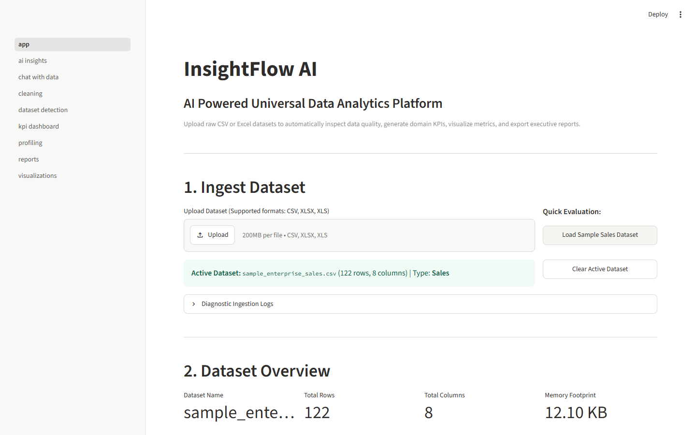
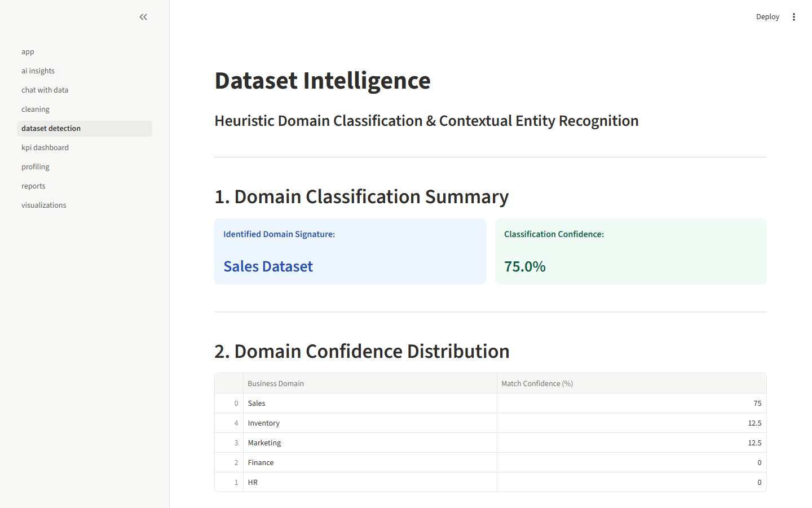
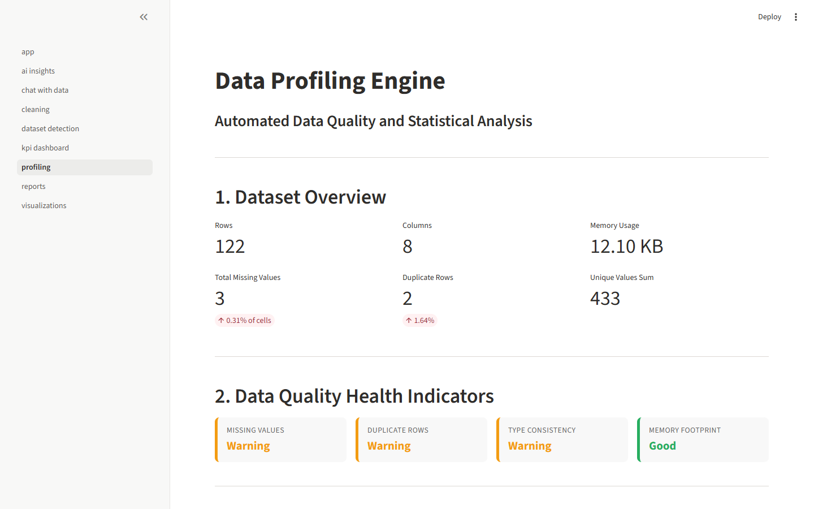
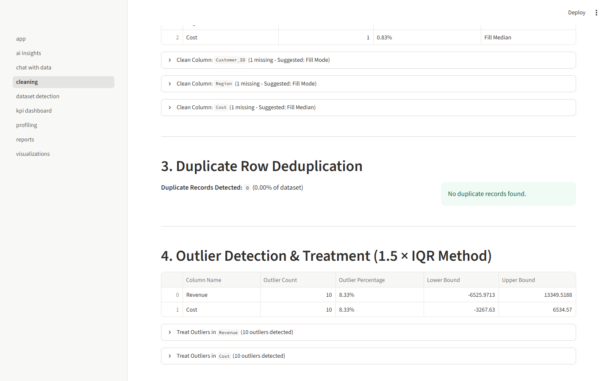
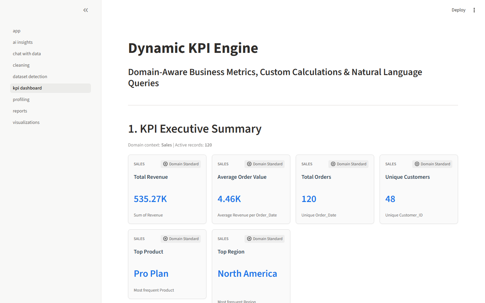
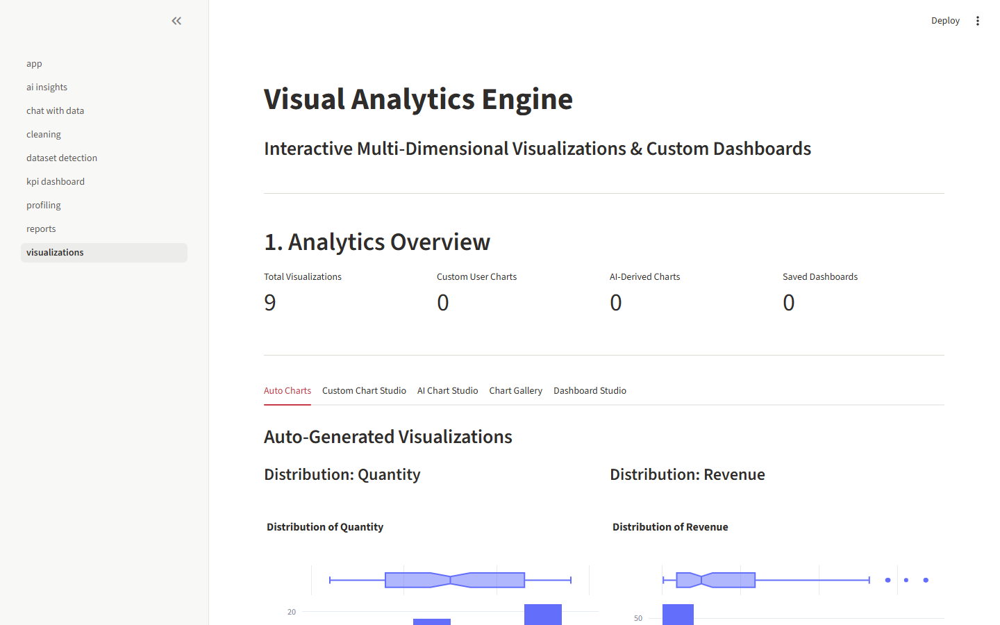
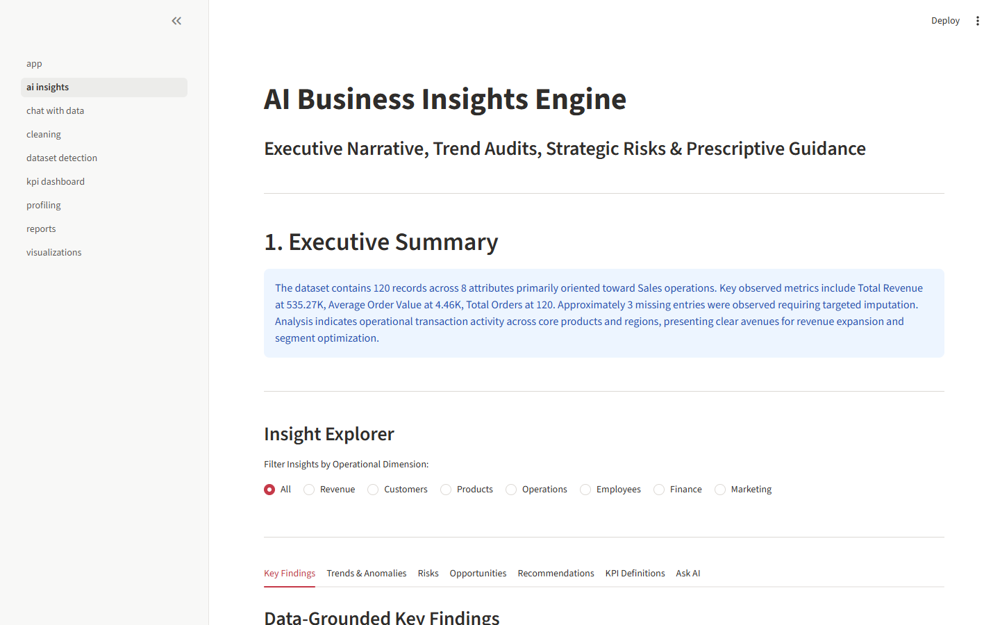
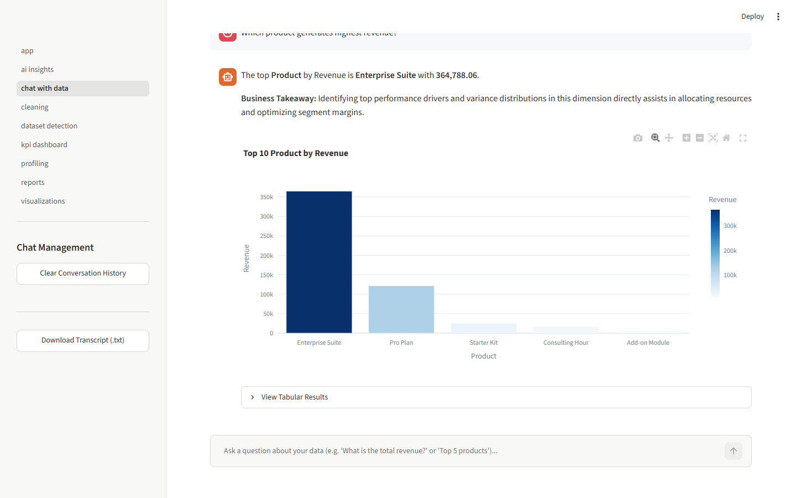
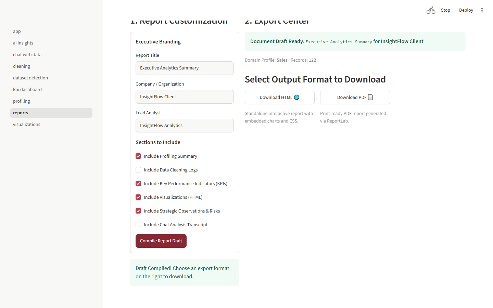
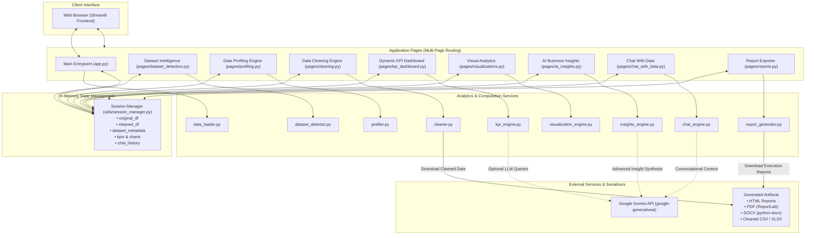

# InsightFlow AI

**An end-to-end, AI-assisted universal data analytics, exploratory data profiling, interactive cleaning, and automated reporting platform built with Python and Streamlit.**

---

## 1. Project Overview

Raw tabular datasets frequently arrive with structural defects: inconsistent character encodings, unexpected delimiters, missing fields, duplicate entries, data type mismatches, and extreme outliers. Preparing these datasets for analysis typically demands repetitive manual scripting before domain metrics or executive visualizations can even be considered.

**InsightFlow AI** resolves this friction by providing a self-contained, modular analytics environment. It automates exploratory data analysis (EDA), identifies dataset business domains through heuristic intelligence, provides an interactive and non-destructive data cleaning workbench, calculates domain-aligned Key Performance Indicators (KPIs), generates interactive Plotly visualizations, offers a conversational natural-language querying interface, and exports executive-ready reports across multiple document formats (HTML, PDF, DOCX, TXT).

### Target Users and Primary Use Cases

- **Data Analysts & Business Intelligence Teams:** Accelerate initial dataset reconnaissance, statistical profiling, and data hygiene audits without writing repetitive pandas scripts.
- **Operations & Business Managers:** Ingest operational exports (sales registers, HR rosters, financial summaries) and immediately receive domain-specific KPI dashboards, risk analyses, and actionable recommendations.
- **Data Engineers & Developers:** Utilize as an extensible local analytics workbench or portfolio demonstration of modular Streamlit application architecture, rule-based classification pipelines, and safe natural-language query routing.

---

## 2. Core Workflow

```
[Raw File: CSV / XLSX / XLS]
               │
               ▼
   [1. Ingestion & Diagnostics] ────> Fallback Encodings & Delimiter Auto-Detection
               │
               ▼
   [2. Dataset Intelligence]   ────> Heuristic Domain Classification (9 Business Domains)
               │
               ▼
   [3. Statistical Profiling]  ────> Quality Badges, Distributions, Correlations, Outliers
               │
               ▼
   [4. Interactive Cleaning]   ────> Non-Destructive Imputation, Deduplication, IQR Capping
               │
               ▼
   [5. KPIs & Visualizations]  ────> Domain-Specific Metrics & 10+ Interactive Plotly Charts
               │
               ▼
   [6. Insights & Chat Engine] ────> Natural Language Query Execution & Strategic Risk Analysis
               │
               ▼
   [7. Document Generation]    ────> Multi-Format Export: HTML, PDF (ReportLab), DOCX, TXT
```

1. **Ingestion & Metadata Diagnostics:** The application ingests CSV or Excel workbooks, dynamically resolving encodings and delimiters while extracting deep memory usage and dimensional metadata.
2. **Domain Detection:** Column schemas are evaluated against keyword ontologies to classify the data into specific business domains and recommend relevant metrics.
3. **Statistical & Quality Profiling:** Deep inspection calculates central tendencies, dispersion, missing value concentrations, duplicate row percentages, and data quality indicators.
4. **Interactive Data Cleaning:** Users remediate data quality issues using safe transformations (imputation, IQR outlier capping/removal, deduplication, type casting) while maintaining an audit trail.
5. **Metric Calculation & Visualization:** The platform compiles default domain KPIs and renders interactive Plotly charts, supporting custom manual builders and AI-assisted queries.
6. **Conversational Querying & Insights:** Users ask ad-hoc questions through a chat interface that parses intent and executes safe pandas operations, accompanied by structured strategic findings.
7. **Multi-Format Report Generation:** Analytical artifacts are assembled into customized, branded reports ready for download in HTML, PDF, Word (DOCX), or plain text.

---

## 3. Key Features

All features listed below are verified and implemented in the repository codebase:

### Robust Dataset Ingestion (`services/data_loader.py`)
- **Encoding Fallback Sequence:** Progressively tests `utf-8`, `utf-8-sig`, `latin1`, `cp1252`, and `ISO-8859-1` to prevent decode failures on legacy or multi-lingual CSV files.
- **Automatic Delimiter Detection:** Utilizes Python's CSV sniffing engine (`sep=None`, `engine='python'`) to parse comma, semicolon, tab, and pipe-delimited records seamlessly.
- **Excel Parsing:** Ingests modern `.xlsx` and legacy `.xls` workbooks with format validation.
- **Diagnostic Upload Logs:** Detailed UI expander displays each parsing attempt, successful decoders, and structural errors.
- **Deep Memory Profiling:** Accurately measures memory footprint via `df.memory_usage(deep=True)` alongside dimensional statistics.

### Heuristic Dataset Intelligence (`services/dataset_detector.py`)
- **Domain Classification:** Automatically identifies 9 distinct business domains using weighted keyword ontology matching:
  - **Sales:** Transactions, invoices, revenue, products, discounts, regional performance.
  - **HR:** Headcount, departmental distribution, compensation, tenure, attrition indicators.
  - **Finance:** Income, operational expenditures, budgets, cash flow, liabilities.
  - **Marketing:** Campaigns, impressions, CTR, leads, conversions, ad spend.
  - **Inventory:** Stock levels, SKUs, warehouse capacity, reorder thresholds.
  - **Customer Support:** Ticket volumes, resolution times, satisfaction ratings, priority tiers.
  - **Healthcare:** Patient records, clinical metrics, admissions, lengths of stay.
  - **Education:** Student grades, course enrollments, attendance, graduation metrics.
  - **E-Commerce:** Cart checkouts, shipping durations, basket analysis, transactions.
  - **General Dataset:** Fallback domain when keyword confidence is below 20%.
- **Contextual Entity Extraction:** Identifies primary business dimensions and measures for downstream processing.
- **Prescriptive Recommendations:** Generates tailored KPI and visualization recommendations specific to the detected domain.

### Automated Data Profiling (`services/profiler.py`)
- **Statistical Summaries:** Computes Mean, Median, Mode, Min, Max, Standard Deviation, and Variance for all numeric columns.
- **Data Quality Dashboard:** Evaluates four system health indicators with visual status badges (`Good`, `Warning`, `Critical`):
  - Missing Values Ratio
  - Duplicate Rows Ratio
  - Data Type Consistency (mixed-type object detection)
  - Memory Footprint Thresholds
- **Missing Value & Duplicate Analysis:** Sorts and plots columns by missingness and calculates exact duplicate percentages.
- **Correlation Heatmap:** Computes Pearson correlation matrices across numeric dimensions with Plotly heatmaps.
- **Categorical & Temporal Analysis:** Analyzes categorical cardinality, high-frequency categories, temporal boundaries, and date-range timelines.

### Interactive Data Cleaning Pipeline (`services/cleaner.py`)
- **Non-Destructive Operations:** Preserves `original_df` while executing transformations against `cleaned_df`.
- **Missing Value Imputation:** Offers column-level imputation strategies: Mean, Median, Mode, Forward Fill (`ffill`), Backward Fill (`bfill`), or row deletion.
- **Outlier Treatment (IQR Method):** Detects outliers using the standard $1.5 \times \text{IQR}$ rule, allowing users to either remove outlier rows or cap (winsorize) them to boundaries.
- **Type Correction & Normalization:** Detects numeric data stored as strings, date objects stored as strings, and low-cardinality columns suitable for categorical casting.
- **Schema Management:** Interactive column renaming and selective column dropping.
- **Audit Logging & Dataset Export:** Tracks every cleaning action with timestamps and row counts; enables one-click download of cleaned data as CSV or Excel (`.xlsx`).

### Dynamic KPI Engine (`services/kpi_engine.py`)
- **Domain Default KPIs:** Auto-computes standard operational metrics (e.g., Total Revenue, Average Order Value, Customer Count for Sales; Employee Count, Average Salary, Attrition Rate for HR; Net Profit and Profit Margin for Finance).
- **Manual KPI Builder:** Interactive form to compute arbitrary aggregations (`SUM`, `AVG`, `COUNT`, `COUNT DISTINCT`, `MIN`, `MAX`, `MEDIAN`) over selected columns.
- **AI-Assisted KPI Builder:** Parses natural-language metric requests into deterministic pandas aggregations without using unsafe evaluation methods.
- **KPI Repository:** Tabular view of all registered metrics with formulas, author attribution (System, User, AI), and deletion controls.

### Visual Analytics & Dashboard Builder (`services/visualization_engine.py`)
- **Automated Visualization:** Automatically generates histograms, box plots, correlation heatmaps, top-correlated scatter plots, category frequency bars, pie charts, and time-series line plots.
- **Custom Chart Studio:** Configurable chart builder supporting 10 chart types:
  - Bar, Line, Scatter, Pie, Histogram, Box Plot, Area, Density Heatmap, Treemap, Sunburst.
  - Supports X-axis, Y-axis, aggregation functions (`SUM`, `AVG`, `COUNT`, `MIN`, `MAX`, `MEDIAN`, `None`), and categorical color grouping.
- **AI Chart Generation:** Maps natural language prompts (e.g., "monthly trend of revenue", "distribution of departments") to Plotly figure configurations.
- **Dashboard Studio:** Allows saving individual charts into named multi-chart dashboard views for side-by-side comparative inspection.

### Strategic AI Business Insights (`services/insights_engine.py`)
- **Executive Summaries:** Generates narrative overviews highlighting total record volume, core domain focus, and primary KPIs.
- **Categorized Findings:** Prioritized insights (`High`, `Medium`, `Low`) filterable by category (Revenue, Customers, Products, Operations, Employees, Finance, Marketing).
- **Risk, Anomaly & Opportunity Detection:** Identifies concentration dependencies, upper-percentile volume spikes, operational drag, and cross-category opportunities.
- **KPI Contextualization:** Details the business meaning and organizational impact of active metrics.
- **Plain Text Export:** Generates structured, downloadable executive text reports.

### Conversational Data Querying (`services/chat_engine.py`)
- **Analytical Intent Classification:** Classifies user prompts into distinct analytical intents: `Metadata`, `Ranking`, `Distribution`, `Trend`, `Comparison`, `Visualization`, `Insight Request`, or `Aggregation`.
- **Entity & Metric Extraction:** Maps natural language synonyms to matching numerical measures and categorical dimensions in the active dataframe.
- **Safe Execution Pipeline:** Translates inferred intents into deterministic pandas operations rather than generating arbitrary code.
- **Multi-Modal Output:** Displays direct text answers, an interactive Plotly visualization, an expandable raw data table, and business explanations in a continuous chat interface.
- **Transcript Export:** Download full conversational transcripts as plain text files.

### Executive Document Exporting (`services/report_generator.py`)
- **Custom Branding:** Configurable report title, target organization, and analyst name.
- **Modular Compilation:** Selectively toggle sections: Profiling Summaries, Cleaning Logs, KPIs, Interactive Charts, AI Insights, and Chat Transcripts.
- **Multi-Format Delivery:**
  - **HTML:** Standalone, responsive HTML reports with embedded CSS styling, metric cards, and alert containers.
  - **PDF:** Generated via **ReportLab** (`SimpleDocTemplate`, custom `ParagraphStyle`), structuring executive summaries, KPI blocks, and findings.
  - **DOCX:** Native Microsoft Word documents compiled with **python-docx**, formatted with heading hierarchies, bold runs, and bulleted lists.

---

## 4. Screenshots and Interface Walkthrough

Visual captures from the live application running on verified sample enterprise datasets:

### 1. Ingestion & Diagnostics

*Figure 1: Universal dataset ingestion supporting CSV, XLSX, and XLS with automated delimiter detection, multi-encoding fallbacks, and memory profiling.*

---

### 2. Dataset Intelligence & Heuristic Classification

*Figure 2: Automatic domain classification across 9 business ontologies (Sales, HR, Finance, Marketing, etc.) with prescriptive KPI and chart recommendations.*

---

### 3. Statistical Profiling & Quality Indicators

*Figure 3: Deep statistical profiling displaying central tendencies, dispersion, missingness distributions, Pearson correlation heatmaps, and 4 system health badges.*

---

### 4. Interactive Data Cleaning Workbench

*Figure 4: Non-destructive data cleaning workbench supporting column-level imputation (Mean, Median, Mode), 1.5x IQR outlier treatment (capping/removal), deduplication, and export.*

---

### 5. Dynamic KPI Dashboard & Formula Studio

*Figure 5: Operational KPI dashboard compiling domain-specific metrics, arbitrary aggregation formula builders, and AI-assisted metric generation.*

---

### 6. Visual Analytics & Interactive Chart Studio

*Figure 6: Interactive Plotly chart generator supporting 10 visualization types with custom axis mapping, aggregations, color grouping, and dashboard saving.*

---

### 7. Strategic AI Business Insights & Risk Analysis

*Figure 7: Prioritized strategic observations, concentration risk alerts, growth opportunities, and executive summary narratives.*

---

### 8. Conversational Data Querying Interface

*Figure 8: Conversational natural-language interface translating analytical questions into deterministic pandas queries, interactive charts, and business explanations.*

---

### 9. Multi-Format Executive Report Export Center

*Figure 9: Executive document compiler generating customized, branded reports in HTML, PDF (ReportLab), and Microsoft Word (python-docx).*

---

## 5. Technology Stack

### Core Framework & Runtimes
| Technology | Specification | Purpose in Project |
|---|---|---|
| **Python** | `>= 3.10` (`3.12.10` target) | Core runtime environment (`runtime.txt`). |
| **Streamlit** | `>= 1.49.0` | Multi-page web application framework, session state, UI rendering. |

### Data Processing & Scientific Computing
| Library | Specification | Purpose in Project |
|---|---|---|
| **Pandas** | `>= 2.3.0` | Dataframe manipulation, multi-encoding parsing, aggregations, schema validation. |
| **NumPy** | `>= 2.3.0` | Array operations, numeric type handling, quantile computations. |
| **SciPy** | `>= 1.16.0` | Scientific computing and statistical distribution evaluations. |
| **Scikit-learn** | `>= 1.7.0` | Statistical modeling, preprocessing, and machine learning utilities. |

### Visualization & Graphics
| Library | Specification | Purpose in Project |
|---|---|---|
| **Plotly** | `>= 6.3.0` | Interactive charting engine (Heatmaps, Treemaps, Sunbursts, Distributions). |
| **Matplotlib** | `>= 3.10.0` | Static visualization fallback and graphics rendering. |
| **Pillow** | `>= 11.3.0` | Image processing and thumbnail handling for visual assets. |

### Document Compilation & File Serialization
| Library | Specification | Purpose in Project |
|---|---|---|
| **ReportLab** | `>= 4.4.0` | Programmatic PDF report document compilation (`SimpleDocTemplate`). |
| **python-docx** | `>= 1.2.0` | Microsoft Word (`.docx`) executive report generation. |
| **OpenPyXL** | `>= 3.1.0` | Reading and writing modern Excel workbooks (`.xlsx`). |
| **XlsxWriter** | `>= 3.2.0` | Formatted Excel workbook serialization for cleaned dataset exports. |

### AI Services & Network
| Library | Specification | Purpose in Project |
|---|---|---|
| **google-generativeai** | `>= 0.8.0` | Google Gemini API integration for unstructured insights and advanced summaries. |
| **Requests** | `>= 2.32.0` | Synchronous HTTP communication for external API services. |

### Testing & QA Automation
| Library | Specification | Purpose in Project |
|---|---|---|
| **pytest** | `>= 9.0.0` | Core test runner for automated unit and service integration test suites. |
| **pytest-cov** | `>= 7.0.0` | Test execution coverage analysis across data ingestion and profiling logic. |
| **Playwright** | `>= 1.50.0` | Headless/headed browser automation driving end-to-end user journeys and screenshot capture. |

---

## 6. System Architecture

The following diagram illustrates the flow of data from ingestion through session state management, analytical engines, and output generation:



### Architectural Highlights

1. **State Isolation & Decoupling:** Pages do not invoke each other directly. Instead, all cross-module data exchange occurs via Streamlit's `st.session_state` wrapped by `utils/session_manager.py`.
2. **Stateless Service Layer:** Every module in `services/` contains pure or deterministic functions accepting data structures (DataFrames, dictionaries, strings) and returning analytical outputs. This facilitates unit testing and portability.
3. **Graceful Degradation:** When the Google Gemini API key is omitted, the application falls back entirely to local rule-based intelligence, keyword classification, and deterministic pandas aggregations without crashing.

---

## 7. Project Structure

```
InsightFlow AI/
├── .streamlit/
│   ├── config.toml             # Headless server, CORS, and telemetry configurations
│   └── secrets.toml            # Local secrets store (ignored by git; holds API credentials)
├── assets/
│   └── screenshots/            # Verified application interface captures (01 to 09)
├── pages/
│   ├── ai_insights.py          # Executive summaries, risk analysis, and actionable insights
│   ├── chat_with_data.py       # Conversational analytics interface with Plotly output
│   ├── cleaning.py             # Non-destructive interactive data cleaning workbench
│   ├── dataset_detection.py    # Business domain classification & entity recognition
│   ├── kpi_dashboard.py        # Domain KPI tracking, manual and natural-language builders
│   ├── profiling.py            # Statistical summaries, missingness, and quality indicators
│   ├── reports.py              # Multi-format report builder (HTML, PDF, DOCX)
│   └── visualizations.py       # Auto-chart generator, custom chart studio, and dashboards
├── services/
│   ├── ai_service.py           # Centralized Google Gemini client with graceful fallback
│   ├── chat_engine.py          # Intent classification, entity extraction, and query execution
│   ├── cleaner.py              # Missing value imputation, IQR outlier capping, type conversions
│   ├── data_loader.py          # Multi-encoding CSV reader and Excel parser with diagnostics
│   ├── dataset_detector.py     # Heuristic domain classification and KPI/chart recommendations
│   ├── insights_engine.py      # Strategic finding generation, trend analysis, and text exporter
│   ├── kpi_engine.py           # Domain aggregation calculations and custom metric handlers
│   ├── profiler.py             # Central tendency, correlation matrix, and quality metrics
│   ├── report_generator.py     # ReportLab PDF, python-docx, and HTML document generators
│   └── visualization_engine.py # Plotly figures (10 chart types), auto-visuals, and builders
├── tests/
│   ├── browser_automation.py   # Playwright end-to-end browser test script & screenshot generator
│   ├── test_chat_engine.py     # Intent & query execution unit tests
│   ├── test_cleaner.py         # Imputation, deduplication, IQR capping unit tests
│   ├── test_data_loader.py     # Encoding & delimiter ingestion unit tests
│   ├── test_dataset_detector.py # Domain heuristic classification unit tests
│   ├── test_insights_engine.py # Strategic finding generation unit tests
│   ├── test_kpi_engine.py      # Operational KPI formula unit tests
│   ├── test_profiler.py        # Statistical profiling & health indicator unit tests
│   ├── test_report_generator.py # HTML, PDF, DOCX generation unit tests
│   └── test_visualization_engine.py # Plotly visual generation unit tests
├── utils/
│   └── session_manager.py      # Streamlit session state initialization and retrieval helpers
├── .env.example                # Template for environment variables
├── .gitattributes              # Git line-ending and repository attributes
├── .gitignore                  # Git ignore rules (virtualenvs, secrets, caches, exports)
├── app.py                      # Application entrypoint & dataset upload interface
├── Procfile                    # Web dyno entrypoint for PaaS deployment
├── pytest.ini                  # Pytest configuration and pythonpath mappings
├── README.md                   # Technical project documentation
├── requirements.txt            # Pinned and versioned project dependencies
└── runtime.txt                 # Target Python runtime specification (python-3.12.10)
```

---

## 8. Getting Started

### Prerequisites

- **Python:** Version `3.10` through `3.12` installed on your machine.
- **Git:** Version control client installed.
- **Virtual Environment Tool:** `venv` (bundled with Python) or `conda`.

### Installation Steps

1. **Clone the repository:**
   ```bash
   git clone https://github.com/pratham021234/InsightFlow-AI.git
   cd InsightFlow-AI
   ```

2. **Create and activate an isolated virtual environment:**
   - **Linux / macOS:**
     ```bash
     python3 -m venv venv
     source venv/bin/activate
     ```
   - **Windows (PowerShell):**
     ```powershell
     python -m venv venv
     .\venv\Scripts\Activate.ps1
     ```
   - **Windows (Command Prompt):**
     ```cmd
     python -m venv venv
     .\venv\Scripts\activate.bat
     ```

3. **Upgrade `pip` and install dependencies:**
   ```bash
   pip install --upgrade pip
   pip install -r requirements.txt
   ```

4. **Configure application secrets (Optional for LLM features):**
   Create `.streamlit/secrets.toml` if it does not already exist:
   ```toml
   GEMINI_API_KEY = "your-google-gemini-api-key-here"
   ```

5. **Run the Streamlit application:**
   ```bash
   streamlit run app.py
   ```

6. **Access the application:**
   Open your browser and navigate to `http://localhost:8501`.

---

## 9. Environment Variables and Secrets

The application consumes configuration settings from Streamlit's secrets mechanism (`.streamlit/secrets.toml`) or system environment variables:

| Variable Name | Location | Required | Purpose | Default / Fallback |
|---|---|---|---|---|
| `GEMINI_API_KEY` | `.streamlit/secrets.toml` or OS Env | **Optional** | Authenticates with the Google Gemini API (`google-generativeai`) for advanced unstructured insights and AI prompts. | If missing, the platform automatically utilizes local rule-based heuristics and deterministic pandas logic. |

### Secrets File Example Template

Create a file named `.streamlit/secrets.toml` (this path is already ignored by `.gitignore`):

```toml
# .streamlit/secrets.toml
GEMINI_API_KEY = "AIzaSyYourActualKeyHere"
```

> **Security Note:** Never commit actual API keys or credentials to version control. The repository's `.gitignore` explicitly excludes `.streamlit/secrets.toml` and `.env` files.

---

## 10. API and Architecture Specifications

InsightFlow AI is architected as an **in-process Streamlit analytics dashboard** rather than a decoupled client-server application with an external HTTP REST API.

- **Internal Service APIs:** All data transformations, metrics, and visual rendering logic are exposed through modular Python functions in the `services/` package.
- **External Endpoints:** No external REST, GraphQL, or WebSocket endpoints are hosted by this application.
- **External API Consumption:** The application optionally calls the **Google Gemini API** through the `google-generativeai` client library when generating LLM-assisted summaries.
- **Client Communication:** Real-time user interactions are handled over Streamlit's internal WebSocket protocol connecting the browser interface to the active Python kernel.

---

## 11. Testing and Verification

### Automated Test Suite (Pytest)

The repository includes a comprehensive automated unit and integration test suite organized under `tests/`. All tests run against verified analytical functions and synthetic boundary datasets:

```powershell
# Run the complete automated test suite
.\venv\Scripts\pytest -v

# Run with test coverage analysis
.\venv\Scripts\pytest --cov=services -v
```

#### Test Suite Breakdown (39 Tests — 100% Pass Rate)

| Test Module | Tests | Focus Area |
|---|---|---|
| [`tests/test_data_loader.py`](tests/test_data_loader.py) | 7 | Encodings (`utf-8`, `latin1`, `cp1252`), custom delimiters (`;`, `\t`), `.xlsx`/`.xls` parsing, empty file validation. |
| [`tests/test_dataset_detector.py`](tests/test_dataset_detector.py) | 5 | Heuristic domain classification (Sales, HR, General), entity extraction, prescriptive recommendations. |
| [`tests/test_profiler.py`](tests/test_profiler.py) | 5 | Overview metrics, data types, central tendencies, Pearson correlation matrices, 4 health indicator badges. |
| [`tests/test_cleaner.py`](tests/test_cleaner.py) | 4 | Missing value detection/imputation, duplicate removal, $1.5 \times \text{IQR}$ outlier detection/capping, column operations. |
| [`tests/test_kpi_engine.py`](tests/test_kpi_engine.py) | 4 | Domain aggregations (Sales, HR, Finance), manual calculation formulas, safe natural language query mapping. |
| [`tests/test_visualization_engine.py`](tests/test_visualization_engine.py) | 4 | Auto-chart heuristics, custom chart generation (Bar, Pie, Heatmap, Scatter), AI prompt chart mapping. |
| [`tests/test_insights_engine.py`](tests/test_insights_engine.py) | 3 | Executive summary compilation, prioritized key findings, structured text export formatting. |
| [`tests/test_chat_engine.py`](tests/test_chat_engine.py) | 4 | Intent classification (`Metadata`, `Ranking`, `Aggregation`), entity mapping, deterministic pandas execution. |
| [`tests/test_report_generator.py`](tests/test_report_generator.py) | 3 | HTML template rendering, ReportLab PDF table generation, Microsoft Word (`.docx`) file serialization. |

### End-to-End Browser Automation (Playwright)

End-to-end user workflows and responsive behavior are verified using headless Chrome automation with Playwright ([`tests/browser_automation.py`](tests/browser_automation.py)):

```powershell
# Execute complete browser test suite and capture interface screenshots
.\venv\Scripts\python tests/browser_automation.py
```

#### Verified User Scenarios (11/11 Passed):
1. **Scenario A:** Application landing, page title verification, clean initial state.
2. **Scenario B:** Built-in sales dataset ingestion, metadata cards, dimensional validation.
3. **Scenario C:** Dataset Intelligence routing, domain classification, ontology entities.
4. **Scenario D:** Statistical profiling, central tendencies, missingness distribution, health badges.
5. **Scenario E:** Interactive data cleaning workbench, IQR outlier detection, imputation audit log.
6. **Scenario F:** Dynamic KPI dashboard, domain metrics, custom formula calculation.
7. **Scenario G:** Visual Analytics studio, multi-type chart rendering, dashboard studio saving.
8. **Scenario H:** Strategic AI business insights, prioritized findings, risk and anomaly detection.
9. **Scenario I:** Conversational analytics chat interface, intent mapping, dynamic chart output.
10. **Scenario J:** Multi-format report exporter, executive branding, draft compilation.
11. **Scenario K:** Responsive viewport verification (mobile $375 \times 667$ screen rendering).

---

## 12. Security and Engineering Decisions

### 1. In-Memory Processing & Privacy
- **No Database Persistence:** Uploaded records reside in memory within the active Python session (`st.session_state`). When the session terminates, uploaded datasets are garbage collected, preventing data leakage on shared hosting environments.
- **Non-Destructive Manipulation:** Data cleaning operations never mutate the initial uploaded DataFrame. All transformations create explicit copies (`df.copy()`), allowing users to reset their working state at any time.

### 2. Elimination of Dynamic Code Execution (`eval`/`exec`)
- Natural-language query translation in `services/chat_engine.py` and `services/kpi_engine.py` **avoids `eval()` or arbitrary code execution**. User queries are mapped to predefined, deterministic pandas aggregation functions (`groupby`, `sum`, `mean`, `count`), eliminating Python code injection vulnerabilities.

### 3. Graceful Rule-Based Degradation
- All analytics modules (domain classification, KPI calculation, statistical profiling, and chart construction) operate on deterministic algorithms. External LLM connectivity is strictly treated as an optional enhancement; the platform remains fully functional in air-gapped or offline environments.

### 4. Robust Ingestion Fault Tolerance
- File loading incorporates multiple decode attempts (`utf-8`, `utf-8-sig`, `latin1`, `cp1252`, `ISO-8859-1`) combined with boundary-checked exception handling (`EmptyDataError`, `UnicodeDecodeError`) to prevent application crashes on invalid user input.

---

## 13. Current Development Status

| Module / Component | Implementation Status | Description |
|---|---|---|
| **Dataset Ingestion** | **Completed** | Full support for CSV/XLSX/XLS with encoding and delimiter auto-detection. |
| **Dataset Intelligence** | **Completed** | Heuristic keyword classification across 9 business domains with entity extraction. |
| **Data Profiling Engine** | **Completed** | Statistical summaries, correlation heatmaps, missing value analysis, and health badges. |
| **Data Cleaning Engine** | **Completed** | Interactive missing value imputation, IQR outlier treatment, deduplication, and export. |
| **KPI Dashboard Engine** | **Completed** | Domain default metrics, manual calculation builder, and formula tracking. |
| **Visual Analytics Engine** | **Completed** | 10 Plotly chart types, custom aggregations, and multi-chart dashboard saving. |
| **AI Business Insights** | **Completed** | Prioritized findings, executive summaries, risk identification, and text export. |
| **Chat With Data** | **Completed** | Heuristic intent classification, entity mapping, chart generation, and transcript export. |
| **Document Exporting** | **Completed** | Modular report generation in HTML, PDF (ReportLab), and DOCX (python-docx). |
| **LLM Deep Integration** | **Completed (with Graceful Degradation)** | Centralized Gemini AI client (`services/ai_service.py`) supporting dynamic executive narratives, safe KPI synthesis, and seamless offline heuristic fallback. |
| **Automated Test Suite** | **Completed** | 39 Pytest unit/integration tests with 100% pass rate + 11 Playwright browser end-to-end automated verification scenarios. |
| **Database Connectors** | **Planned** | Direct SQL ingestion from PostgreSQL, MySQL, and Snowflake. |

---

## 14. Future Improvements

- **Database Ingestion:** Add native SQL connectors to stream data directly from PostgreSQL, MySQL, Google BigQuery, and Snowflake.
- **Large Dataset Optimization:** Integrate Apache Arrow and Polars backends to accelerate processing for multi-gigabyte files that exceed standard pandas memory thresholds.
- **Automated Machine Learning (AutoML):** Introduce baseline supervised regression, classification, and time-series forecasting pipelines using `scikit-learn`.
- **Docker Containerization:** Add production-grade `Dockerfile` and `docker-compose.yml` configurations with automated GitHub Actions CI/CD workflows.

---

## 15. Contributing

Contributions are welcome. To maintain engineering standards, please adhere to the following workflow:

1. **Fork the Repository:** Create a personal fork on GitHub.
2. **Create a Feature Branch:**
   ```bash
   git checkout -b feature/your-feature-name
   ```
3. **Commit Your Changes:** Write descriptive, imperative commit messages.
   ```bash
   git commit -m "Add time-series decomposition to profiler service"
   ```
4. **Push to Your Fork:**
   ```bash
   git push origin feature/your-feature-name
   ```
5. **Open a Pull Request:** Describe the rationale, testing performed, and any architectural considerations in your pull request.

---

## 16. License

This repository does not currently include an open-source license file. All rights are reserved by the repository owner ([@pratham021234](https://github.com/pratham021234)). If you intend to use this code commercially or redistribute it, please contact the repository owner for permission or request the addition of an open-source license (such as MIT or Apache 2.0).
